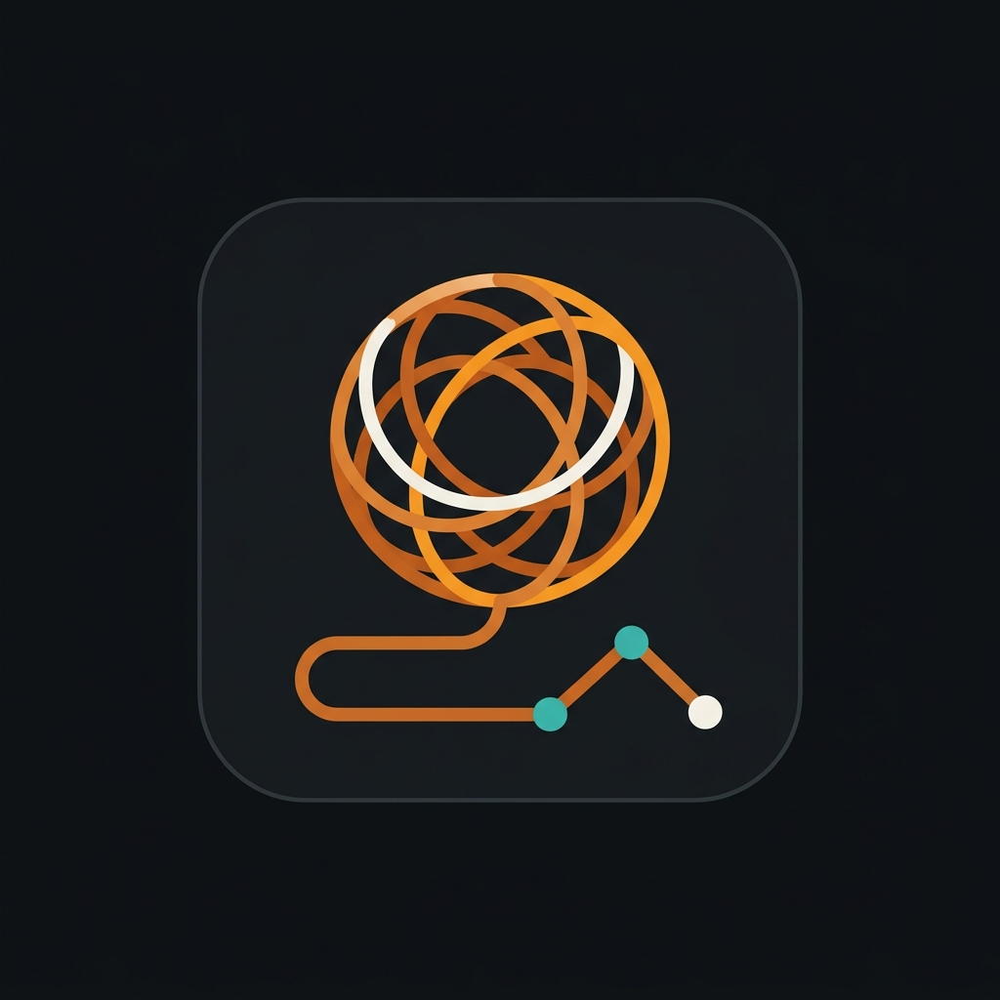
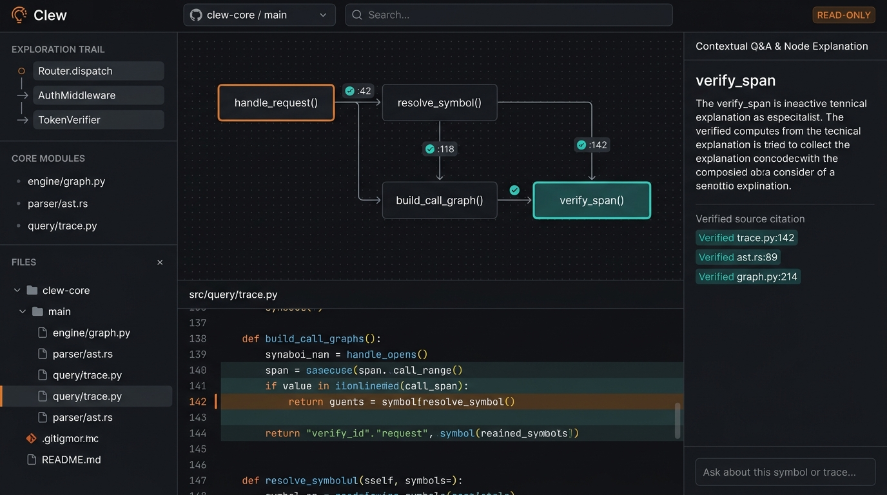
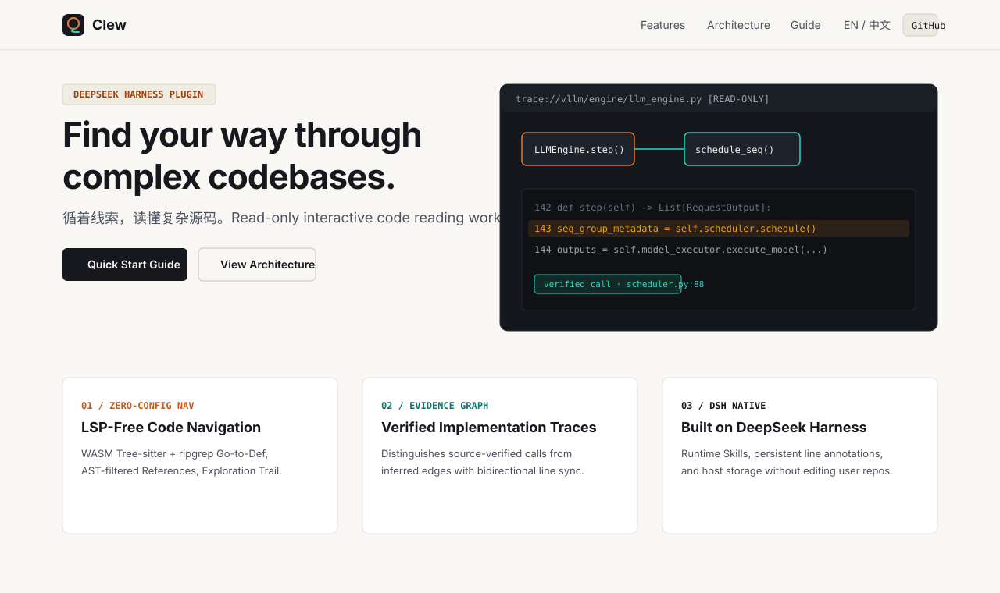
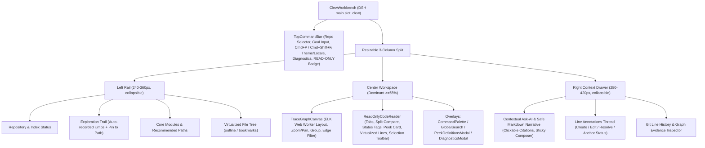
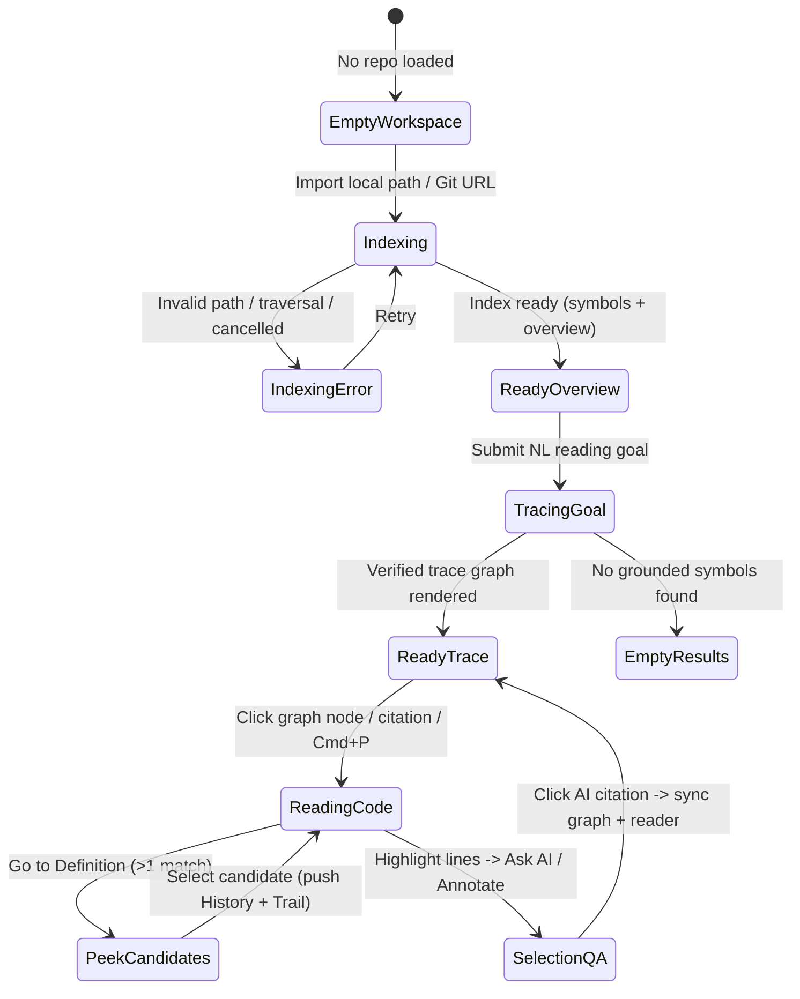

# DESIGN.md — Clew Visual & Interaction Design Specification

> **Clew** — *Find your way through complex codebases.* / *循着线索，读懂复杂源码。*  
> Surface aesthetic: `Professional, Technical, Calm, Editorial, Precise, Compact, Developer-oriented`.

---

## 1. Visual Philosophy & Anti-Slop Rules
- **Source-First Hierarchy**: The interactive trace graph and read-only source reader occupy the dominant center canvas (>=55% of viewport width). Navigation and AI drawers remain compact and collapsible.
- **Restraint Over Ornament**: High-contrast 1px hairline borders, crisp monospace code typography, calm neutral surfaces, and warm copper-amber (`#E07A2F`) + slate-teal (`#2DD4BF` / `#0F766E`) semantic accents derived from the Clew thread-and-node motif.
- **Explicitly Forbidden**:
  - Large blue/purple SaaS gradients, glowing buttons, or neon shadows.
  - Gratuitous glassmorphism (`backdrop-filter` blur cards over busy code).
  - Coloured pill-badge spam or excessive marketing whitespace inside the workbench.
  - Static fake progress percentages or hardcoded placeholder metrics.

---

## 2. Brand Identity & Design-Phase Concept References

> **Strict Rule**: Concept images below were generated strictly for design-phase alignment. Final `README.md`, `docs/UI-REVIEW.md`, and `website/` product showcases MUST use real running browser screenshots.

| Asset | Purpose | Preview |
|---|---|---|
| **Original Brand Mark** | Geometric clew-to-graph icon (zero text, light/dark legible) |  |
| **Brand Exploration** | Nano Banana concept artwork (`1024x1024`) |  |
| **Workbench Concept** | Nano Banana 3-column workbench moodboard (`1376x768`) |  |
| **Homepage Concept** | Editorial SVG wireframe (Nano Banana Image 2 hit 429 quota) |  |

---

## 3. Semantic Design Tokens (Host Theme Integration)
Inside DeepSeek Harness (`dsh`), Clew inherits host light/dark mode (`body[data-ds-dark-theme]`) via `--dsw-alias-*` tokens and layers Clew-scoped `--clew-*` semantic variables with crisp fallbacks for standalone homepage / test rendering:

| Token | Light Mode Value | Dark Mode Value | Usage |
|---|---|---|---|
| `--clew-bg-canvas` | `var(--dsw-alias-bg-base, #F8F7F4)` | `var(--dsw-alias-bg-base, #111317)` | Root workbench / page background |
| `--clew-bg-surface` | `var(--dsw-alias-bg-layer-1, #FFFFFF)` | `var(--dsw-alias-bg-layer-1, #181B21)` | Panels, reader header, cards |
| `--clew-bg-elevated` | `var(--dsw-alias-bg-layer-2, #F1EFE9)` | `var(--dsw-alias-bg-layer-2, #1E222A)` | Popovers, Peek cards, command palette |
| `--clew-bg-code` | `#FCFBF8` | `#0E1014` | Read-only source code viewport |
| `--clew-border-subtle` | `var(--dsw-alias-border-l2, #E4E1DA)` | `var(--dsw-alias-border-l2, #262A33)` | 1px panel dividers & card hairlines |
| `--clew-border-strong` | `var(--dsw-alias-border-l4, #CFCAC0)` | `var(--dsw-alias-border-l4, #353B47)` | Focused inputs, active nodes |
| `--clew-text-primary` | `var(--dsw-alias-label-primary, #16181D)` | `var(--dsw-alias-label-primary, #ECEEF2)` | Headings, symbol names, UI labels |
| `--clew-text-secondary` | `var(--dsw-alias-label-secondary, #4B515C)` | `var(--dsw-alias-label-secondary, #9AA2B1)` | File paths, metadata, captions |
| `--clew-text-muted` | `var(--dsw-alias-label-tertiary, #7A818E)` | `var(--dsw-alias-label-tertiary, #666F80)` | Line numbers, timestamps, shortcuts |
| `--clew-accent-primary` | `#C85A17` | `#E07A2F` | Active trace thread, current line gutter, primary CTA |
| `--clew-accent-verified` | `#0F766E` | `#2DD4BF` | `source_verified_call` badges, verified citations |
| `--clew-accent-inferred` | `#B45309` | `#F59E0B` | `inferred_dynamic` edges, warnings, annotation markers |
| `--clew-accent-danger` | `#B91C1C` | `#F87171` | Errors, cancelled/expired anchor markers |

### Typography & Bilingual Code-Mixed Rhythm
- **UI Sans**: `var(--dsw-font-family-sans, "Inter", "PingFang SC", "Noto Sans SC", system-ui, sans-serif)`
- **Code Monospace**: `var(--dsw-font-family-code, "JetBrains Mono", "Fira Code", ui-monospace, monospace)` with `font-variant-ligatures: none` in the source reader for exact column/selection alignment.
- **Scale**: `11px` micro badges/metadata, `12px` tree rows & dense toolbar controls, `13px` code & body text, `14px` section headings, `16px–18px` panel headers.
- **Spacing & Radii**: 4px base grid (`4, 8, 12, 16, 24`); compact radii (`4px` controls/badges, `6px` panels/nodes, `8px` dialogs/command palette).

---

## 4. Information Architecture & Component Tree (Mermaid)

---

## 5. Core User Journey & Interactive State Transitions (Mermaid)

---

## 6. Required Interactive & Accessibility States
Every data-backed panel must explicitly render:
- `Idle / Empty` (clear onboarding CTA without fake sample results)
- `Loading / Progress` (real staged phase + processed file count + Cancel button)
- `Success` (live interactive state)
- `No Results` (empty search / zero references with recovery hints)
- `Error / Cancelled` (explicit reason + Retry action)
- Full keyboard support (`Cmd/Ctrl+P`, `Cmd/Ctrl+Shift+F`, `Alt+Left/Right` history, `Esc` dismiss, `Tab` focus rings).
