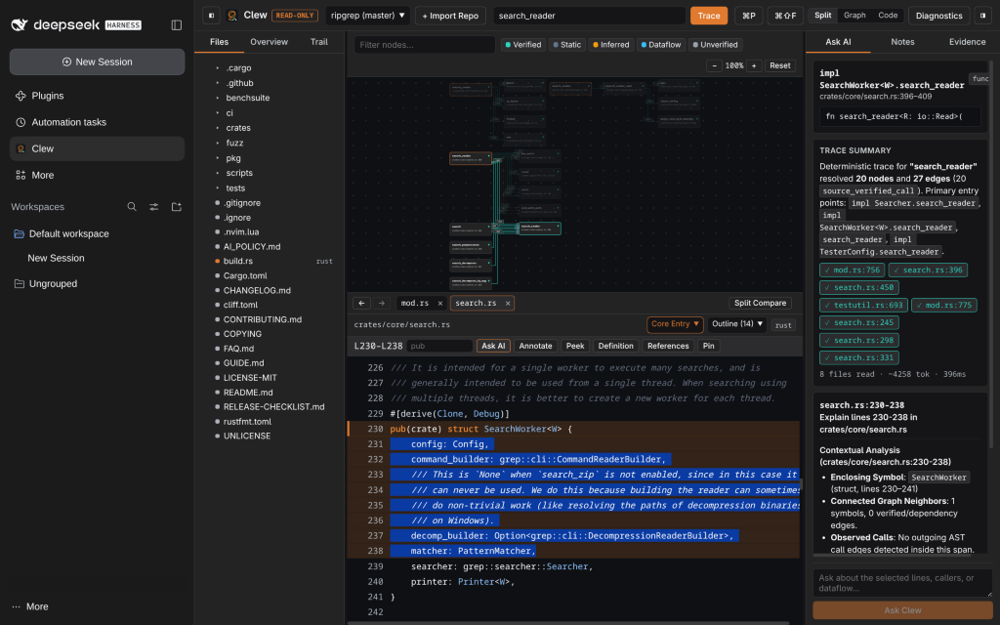
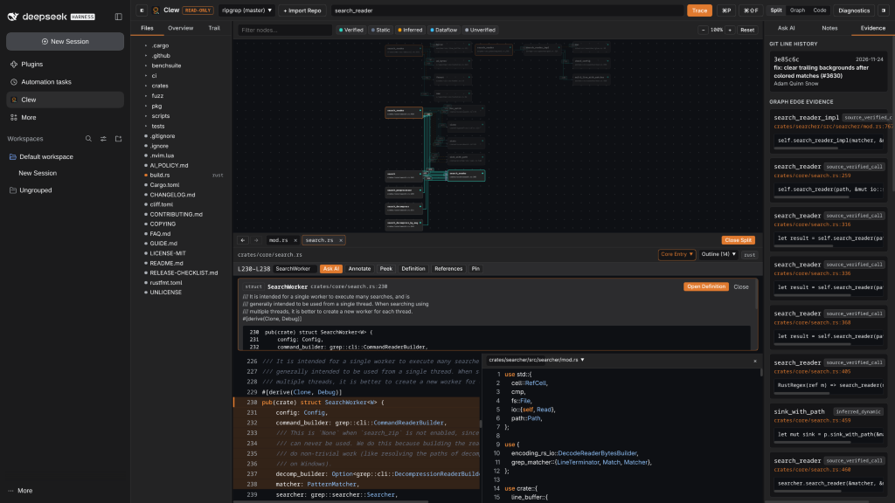
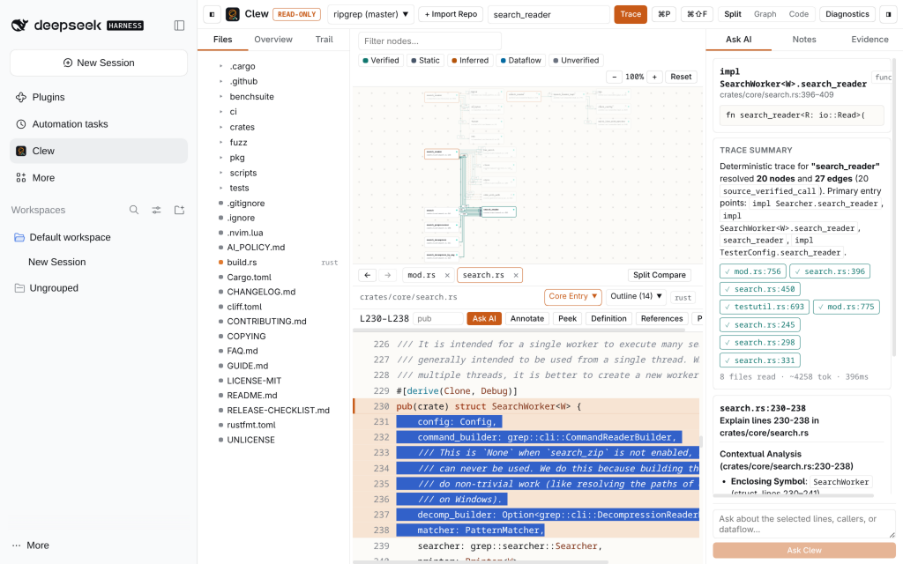
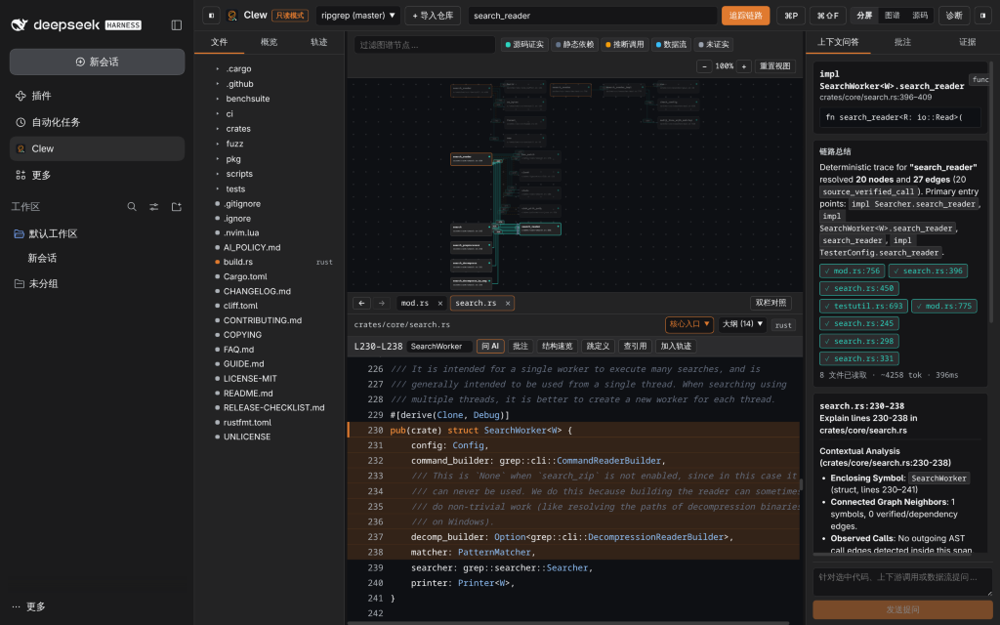
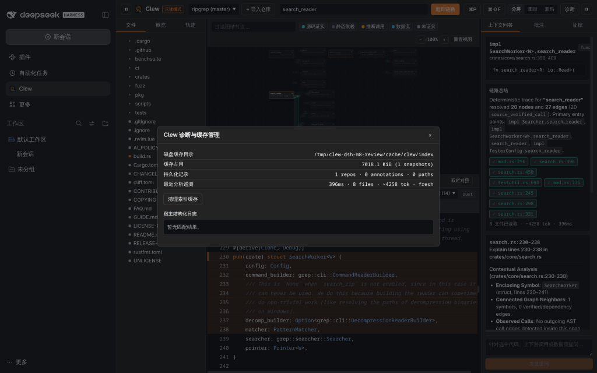

<div align="center">
  
  <h1>Clew</h1>
  <p><strong>Find your way through complex codebases.</strong> · 循着线索，读懂复杂源码。</p>
  <p>An interactive, AI-agent-driven, strictly read-only source code reading & understanding workbench distributed as a native <strong>DeepSeek Harness (<code>dsh</code>)</strong> plugin.</p>
  <p>
    <a href="README.zh-CN.md">简体中文</a> ·
    <a href="https://xzwsloser.github.io/clew/">Product Homepage</a> ·
    <a href="docs/ARCHITECTURE.md">Architecture</a> ·
    <a href="DESIGN.md">Design Spec</a> ·
    <a href="docs/validation/E2E-REPORT.md">OSS Validation</a>
  </p>
</div>

<p align="center">
  
  <br />
  <sub><em>Meet Clew's Pathfinder Fox — follow a single verified thread through unfamiliar codebases.</em></sub>
</p>

---

## Why Clew

Large repositories are rarely read top-to-bottom. Developers need to trace execution paths, jump cleanly across modules without fighting broken LSP toolchains, verify claims directly against source code, and preserve personal reading notes across sessions.

Clew acts as a **zero-config, read-only code reading workbench** inside DeepSeek Harness (`@clew/dsh-plugin`):

- **Strictly Read-Only & Zero Script Execution**: Never modifies user files, compiles code, or runs repository hooks (`core.hooksPath=/dev/null`).
- **Multi-Language Zero-Native Engine**: Powered by `web-tree-sitter@0.26.8` (`.wasm` grammars for **Python, C, C++, Go, Rust, TypeScript, and JavaScript**) + bundled `ripgrep` with zero `node-gyp` native build failures.
- **Zero-Config Code Navigation**: 4-tier ranked Go-to-Definition (lexical scope → resolved import → sibling module → global) with multi-candidate Peek selector, AST-filtered Find References (filtering comments/strings), outline, jump history (`Alt+Left` / `Alt+Right`), `Cmd/Ctrl+P` palette, and `Cmd/Ctrl+Shift+F` ripgrep search.
- **Interactive Trace Graphs with Evidence Verification**: Natural-language reading goals run deterministic bounded subgraph retrieval paired with reverse AST evidence verification (`source_verified_call`, `static_dependency`, `inferred_dynamic`, `dataflow`, `unverified`) rendered via Web Worker `elkjs`.
- **Developer Reading Ergonomics (P0 + P1)**: Virtualized multi-tab reader, Dual-Pane **Split Compare**, non-blocking **Structure Peek Cards**, read-only **Git Line History** (`git log -L`), file **Reading Status Tags** (`Core Entry`, `Deep Dive`, `Understood`), contextual **Ask AI** with clickable verified citations, persistent **Line Annotations** with anchor relocation, **Exploration Trail**, and **Diagnostics / Disk Cache** management.

---

## Real Product Screenshots

### 3-Column Dark Workbench (`1440×900`, Rust `ripgrep`)


### Dual-Pane Split Compare, Structure Peek Card & Git Line History (`1920×1080`)


<details>
<summary>More real screenshots: Light Theme (1280×800), Chinese Locale & Diagnostics</summary>

#### Light Mode Responsive Workbench (`1280×800`)


#### Simplified Chinese UI (`1440×900`)


#### Diagnostics & Disk Cache Snapshot


</details>

---

## Quick Start (DeepSeek Harness)

### Prerequisites
- **Node.js** `22+` (verified on `v26.13.1`)
- **DeepSeek Harness (`dsh`)** `>= 0.2.1`
- **`ripgrep` (`rg`)** installed on `PATH`
- Optional: `git` on `PATH` for branch/SHA metadata & line-level commit history

### Install from Local Build
```bash
git clone https://github.com/xzwsloser/clew.git
cd clew
pnpm install --ignore-scripts
pnpm run build
dsh plugin --profile web add "$(pwd)/packages/plugin"
dsh web --port 18765 --host 127.0.0.1
```

Open the printed URL (including your local auth token), click **Clew** in the left navigation rail, click **+ Import Repo**, choose a local directory or HTTPS/SSH Git URL, and start tracing.

---

## Verified Real-World Multi-Language Benchmarks

Tested end-to-end against pinned real OSS commits ([full E2E report](docs/validation/E2E-REPORT.md)):

| Repository | Stack | Pinned SHA | Files / Symbols | Cold Index | Warm Cache Hit |
|---|---|---|---|---:|---:|
| **BurntSushi/ripgrep** | Rust (`Cargo`) | `3e85c6c` | `221` / `4,116` | `2,613 ms` | `458 ms` (`~5.7×`) |
| **gin-gonic/gin** | Go (`Go Modules`) | `eb4d4b5` | `129` / `1,643` | `1,225 ms` | `162 ms` (`~7.6×`) |
| **ggml-org/llama.cpp** | C++, C, Python, TS, JS | `8e23278` | `4,737` / `48,952` | `44,577 ms` | `7,590 ms` (`~5.9×`) |

---

## Monorepo Architecture

```
clew/
├── packages/
│   ├── shared/     # @clew/shared — Zod IPC/storage schemas, error codes, path-safety & symlink guard
│   ├── engine/     # @clew/engine — Host-agnostic scanner, WASM Tree-sitter parsers, symbol index, navigation, trace verifier
│   └── plugin/     # @clew/dsh-plugin — DeepSeek Harness Cordis plugin, services, tools, runtime skills & React UI
├── website/        # Static GitHub Pages product homepage
├── docs/
│   ├── ARCHITECTURE.md
│   ├── UI-REVIEW.md
│   ├── validation/E2E-REPORT.md
│   ├── discussions/
│   ├── adr/
│   └── release/DSH-PLUGIN-SUBMISSION.md
└── DESIGN.md
```

For development workflows and checks, see [`CONTRIBUTING.md`](CONTRIBUTING.md) and [`CHANGELOG.md`](CHANGELOG.md).

## License
Licensed under the [MIT License](LICENSE).
