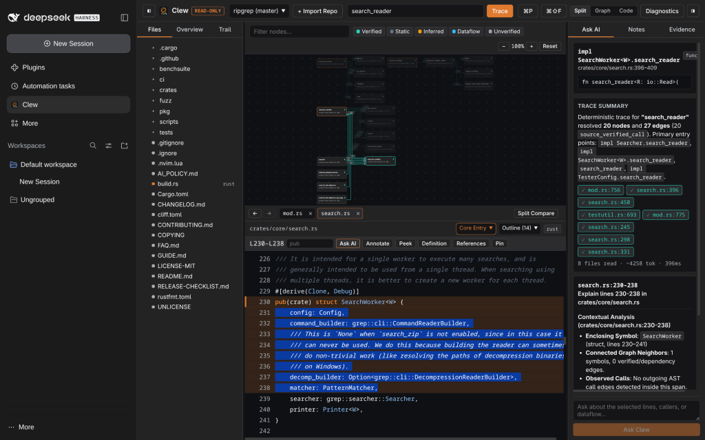
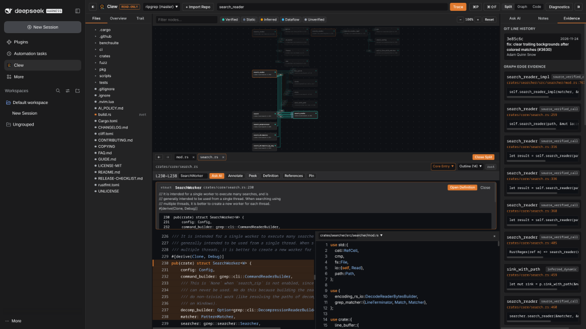
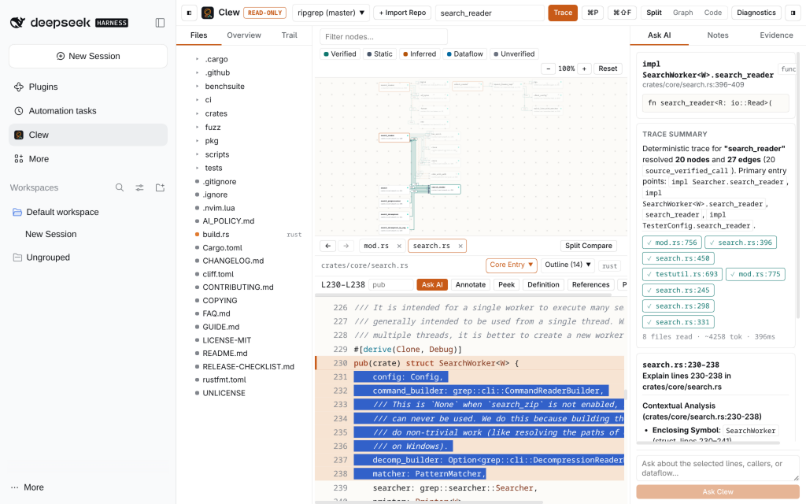
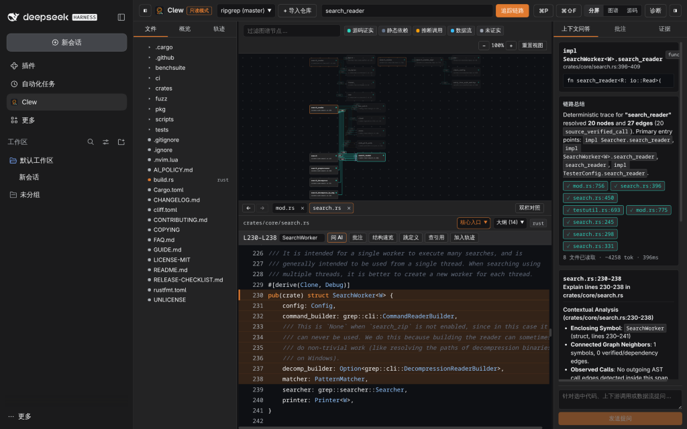
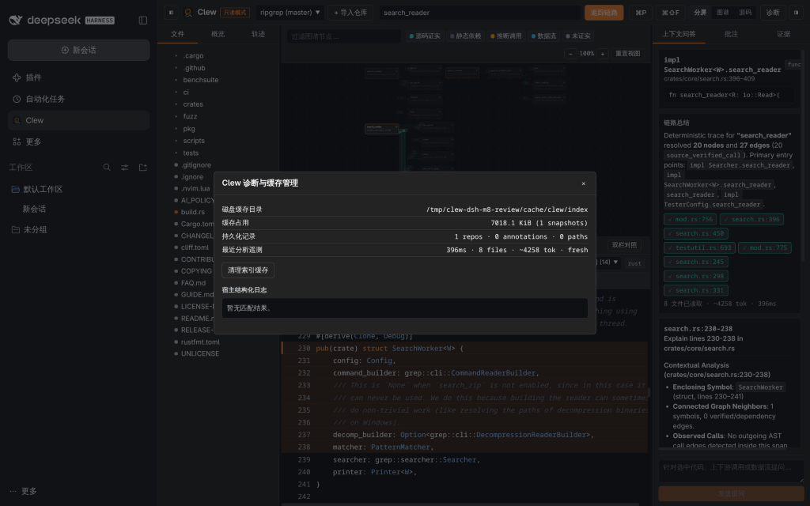

<div align="center">
  
  <h1>Clew · 源码线索工作台</h1>
  <p><strong>循着线索，读懂复杂源码。</strong> · <em>Find your way through complex codebases.</em></p>
  <p>面向大型复杂代码仓库的只读交互式源码阅读与实现链路理解工作台，作为 <strong>DeepSeek Harness (<code>dsh</code>)</strong> 原生插件发布。</p>
  <p>
    <a href="README.md">English</a> ·
    <a href="https://xzwsloser.github.io/clew/">产品主页</a> ·
    <a href="docs/ARCHITECTURE.md">架构文档</a> ·
    <a href="DESIGN.md">设计规范</a> ·
    <a href="docs/validation/E2E-REPORT.md">多语言验收报告</a>
  </p>
</div>

<p align="center">
  
  <br />
  <sub><em>Clew 探险小狐狸吉祥物 —— 握紧唯一线索，一步步看清复杂系统。</em></sub>
</p>

---

## 为什么选择 Clew

面对跨模块、多语言的大型工程或开源代码库，传统阅读方式往往受限于脆弱的 LSP 环境配置与浅层的代码聊天问答。Clew 通过**确定性源码索引 + 零配置轻量导航 + 可验证实现链路图谱 + 持久化学习笔记**，帮开发者在完全零配置的前提下高效读懂复杂系统：

- **严格只读、绝不执行目标仓库脚本**：绝不修改源代码，绝不编译工程，Git 克隆强制启用 `core.hooksPath=/dev/null`。
- **零原生编译多语言引擎**：基于 `web-tree-sitter@0.26.8`（`.wasm` 语法包支持 **Python、C、C++、Go、Rust、TypeScript、JavaScript**）+ `ripgrep`，彻底规避 `node-gyp` 编译失败。
- **零配置轻量代码导航**：4 级优先级定义跳转（局部作用域 → 解析导入 → 同级模块 → 全局）、AST 过滤引用查找（剔除注释与字符串误报）、大纲目录、前后跳转历史栈（`Alt+Left` / `Alt+Right`）、`Cmd/Ctrl+P` 快速定位与 `Cmd/Ctrl+Shift+F` 全文搜索。
- **带源码证据校验的实现链路图谱**：输入自然语言阅读目标即可生成确定性有界子图，经 AST 反向核验（区分 `源码证实`、`静态依赖`、`推断调用`、`数据流` 与 `未证实`），并由 Web Worker 驱动 ELK 自动布局。
- **高密度开发者阅读体验（P0 + P1）**：虚拟化多标签源码阅读器、双栏 **Split Compare** 对照、非阻塞**数据结构速览卡（Peek）**、只读**行级 Git 提交历史**、文件**阅读状态标记**（核心入口 / 深入研读 / 已理解）、划词 **Ask AI** 上下文问答与可点击引用、行级批注与跨会话恢复。

---

## 真实运行界面截图

### 深色三栏核心工作台（`1440×900`，Rust `ripgrep`）


### 双栏对照、结构速览卡与行级 Git 提交历史（`1920×1080`）


<details>
<summary>更多真实截图：浅色主题（1280×800）、简体中文界面与诊断面板</summary>

#### 浅色主题与紧凑笔记本适配（`1280×800`）


#### 简体中文工作台（`1440×900`）


#### 诊断信息与磁盘缓存面板


</details>

---

## 快速开始（DeepSeek Harness）

### 环境要求
- **Node.js** `22+`（已在 `v26.13.1` 实测通过）
- **DeepSeek Harness (`dsh`)** `>= 0.2.1`
- 系统 `PATH` 中已安装 **`ripgrep` (`rg`)**
- 可选：系统 `git`，用于读取分支 / Commit SHA 及行级提交历史

### 本地安装与启动
```bash
git clone https://github.com/xzwsloser/clew.git
cd clew
pnpm install --ignore-scripts
pnpm run build
dsh plugin --profile web add "$(pwd)/packages/plugin"
dsh web --port 18765 --host 127.0.0.1
```

打开终端输出的地址（携带本地访问 token），在左侧栏点击 **Clew**，点击 **+ 导入仓库** 选择本地源码目录或 Git URL 即可开始阅读。

---

## 多语言真实开源仓库实测基准

已在三个固定 Commit SHA 的真实开源仓库完成端到端实测（详情见 [E2E 验证报告](docs/validation/E2E-REPORT.md)）：

| 开源仓库 | 语言技术栈 | 固定 Commit SHA | 文件 / 符号数 | 冷构建耗时 | 热缓存复用 |
|---|---|---|---:|---:|---:|
| **BurntSushi/ripgrep** | Rust (`Cargo`) | `3e85c6c` | `221` / `4,116` | `2,613 ms` | `458 ms` (`~5.7×`) |
| **gin-gonic/gin** | Go (`Go Modules`) | `eb4d4b5` | `129` / `1,643` | `1,225 ms` | `162 ms` (`~7.6×`) |
| **ggml-org/llama.cpp** | C++、C、Python、TS、JS | `8e23278` | `4,737` / `48,952` | `44,577 ms` | `7,590 ms` (`~5.9×`) |

---

## 仓库结构

```
clew/
├── packages/
│   ├── shared/     # @clew/shared — Zod 契约、错误码、路径越界与符号链接逃逸防护
│   ├── engine/     # @clew/engine — 宿主无关源码扫描、WASM Tree-sitter 解析、索引、导航与图谱校验引擎
│   └── plugin/     # @clew/dsh-plugin — DeepSeek Harness Cordis 插件宿主机适配与 React 工作台 UI
├── website/        # GitHub Pages 静态产品主页
├── docs/
│   ├── ARCHITECTURE.md
│   ├── UI-REVIEW.md
│   ├── validation/E2E-REPORT.md
│   ├── release/DSH-PLUGIN-SUBMISSION.md
│   └── adr/
└── DESIGN.md
```

开发规范与提交流程请参阅 [`CONTRIBUTING.md`](CONTRIBUTING.md) 与 [`CHANGELOG.md`](CHANGELOG.md)。

## 开源协议
本项目基于 [MIT 协议](LICENSE) 开源。
