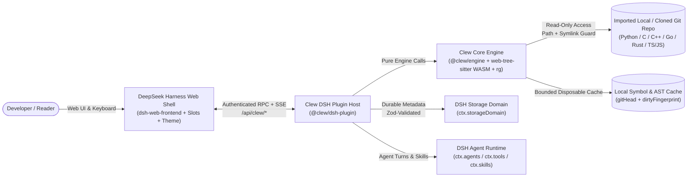
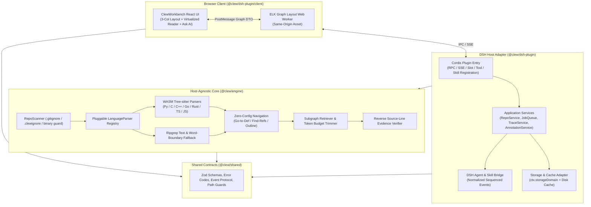
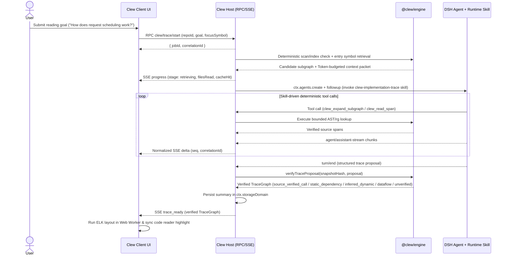
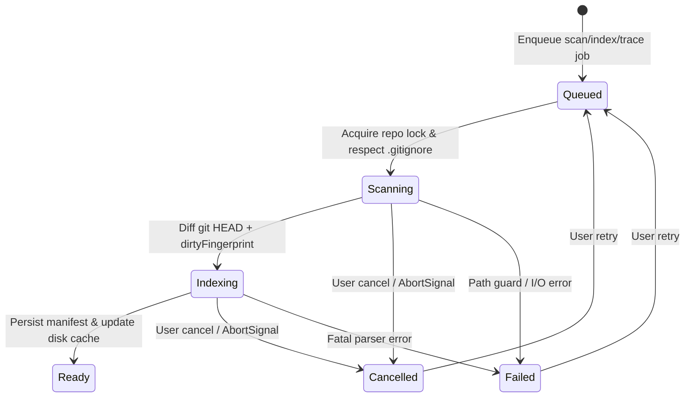

# ARCHITECTURE.md — Clew System Architecture

> **Clew** — *Find your way through complex codebases.* / *循着线索，读懂复杂源码。*

## 1. Architectural Principles
1. **Hexagonal Layering**: Pure core understanding engine (`@clew/engine`) and shared Zod contracts (`@clew/shared`) have zero dependency on DeepSeek Harness (`cordis`), React, or browser APIs.
2. **Reuse the Harness**: Clew never implements its own LLM gateway, model credentials, or agent loop; it composes `ctx.agents`, `ctx.tools`, `ctx.skills`, `ctx.storageDomain`, `ctx.connection`, and `ctx.slots`.
3. **Strict Read-Only & Untrusted Data Boundary**: Clew never edits files or executes scripts inside user repositories. All paths undergo traversal + `realpath` symlink-escape checks; source snippets are treated strictly as untrusted data.
4. **Deterministic-First + Reverse Verification**: Tree-sitter WASM + `ripgrep` perform deterministic indexing, navigation, and subgraph retrieval; every LLM-proposed trace edge is verified against immutable source hashes before presentation.

---

## 2. System Context Diagram

---

## 3. Hexagonal Module Dependency & Multi-Language Parser Extension

---

## 4. Core Execution Sequence (Reading Goal -> Trace Graph -> Verified UI)

---

## 5. Background Job State Machine & Cache/Data Flow

### Storage Split Summary
- **`ctx.storageDomain` (Durable User State)**: Imported repo metadata, saved reading paths, exploration trails, line annotations (with anchor commit/hash), user settings, and compact trace history.
- **Disposable Local Disk Cache (`$DSH_HOME/cache/clew/`)**: Per-file parsed symbol tables, import graphs, and AST line maps keyed by `(repoRoot, gitHead, dirtyFingerprint, parserVersion)`. Automatically invalidated via `git diff --name-status` and safely rebuilt on miss or corruption.
