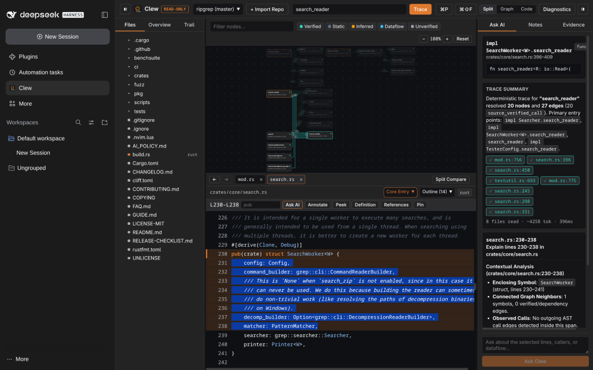
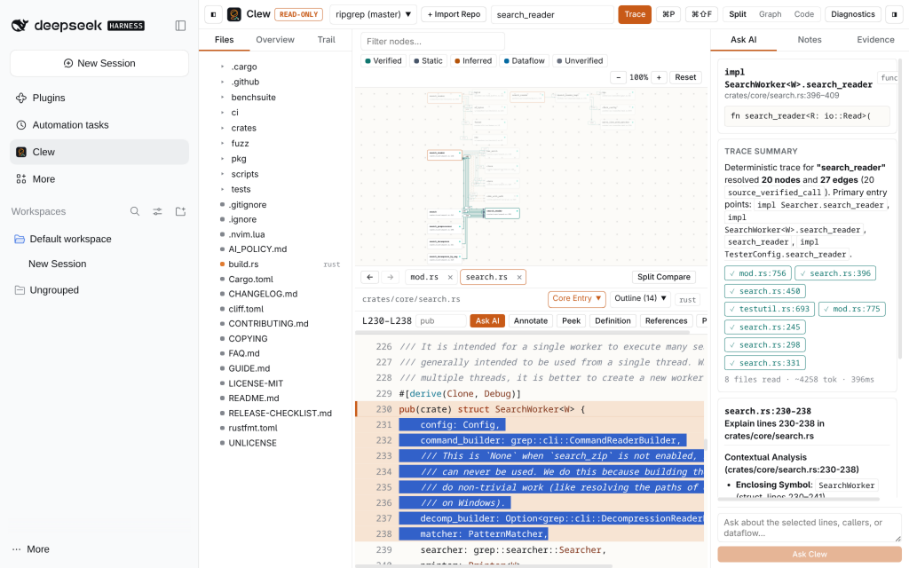
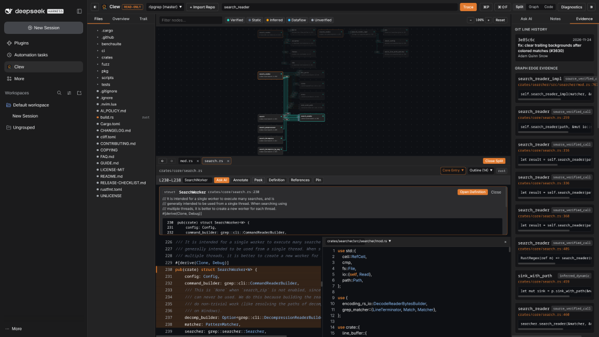
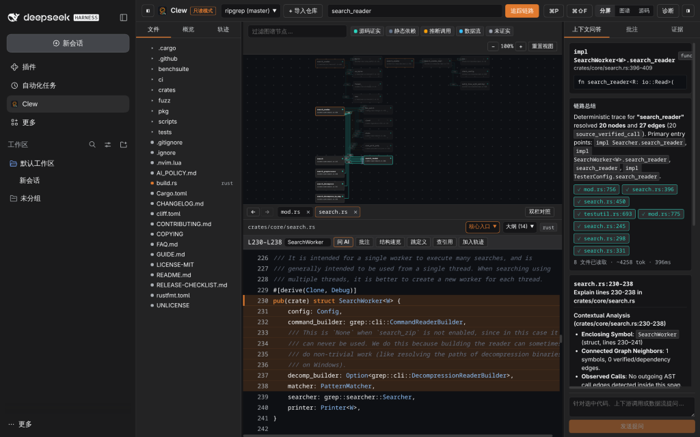
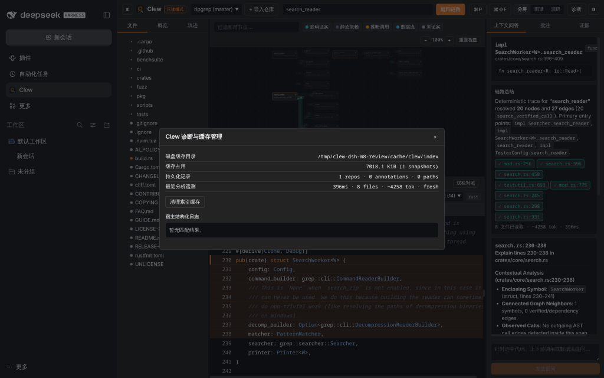

# Clew UI/UX Review, Visual Audit & Hardening Report (M8)

> Two-round visual & interactive review conducted against live DeepSeek Harness (`dsh web`) running Clew on real open-source repositories (`ripgrep`, `clew`), evaluated against [`DESIGN.md`](../DESIGN.md), `clew-ui-review`, and `impeccable` criteria.

---

## 1. Visual & Viewport Matrix

| View | Viewport | Theme | Locale | Real Browser Screenshot |
|---|---|---|---|---|
| **3-Column Workbench (Graph + Code + Ask AI)** | `1440×900` | Dark | `EN` |  |
| **Compact Laptop Fit & Light Contrast** | `1280×800` | Light | `EN` |  |
| **Dual-Pane Split Compare + Peek + Git Line History** | `1920×1080` | Dark | `EN` |  |
| **Chinese Workbench & Mixed Code Typography** | `1440×900` | Dark | `ZH` |  |
| **Diagnostics & Disk Cache Controls** | `1440×900` | Dark | `EN/ZH` |  |

---

## 2. Round 1 Findings -> Round 2 Fixes

| # | Round 1 Defect Observed | Resolution Applied | Round 2 Verification Result |
|---|---|---|---|
| 1 | Ask AI textarea & `Ask Clew` submit button pushed below the fold at `1280×800` and `1440×900` | Switched `.clew-qa-pane` to `display: flex; flex-direction: column` with scrollable `.clew-qa-scroll` above sticky `.clew-qa-form` | **Verified**: Input & submit button fit cleanly inside `800px` (`y=722..792`) and `900px` (`y=818..892`) |
| 2 | Trace Summary & Ask AI rendered literal `###`, `**`, and backticks | Added XSS-safe React Markdown subset renderer (`SimpleMarkdown.tsx`) supporting headings, lists, bold, italic, and inline code | **Verified**: `hasRawMarkdown: false`; clean bold, inline code badges, and bullets rendered |
| 3 | Clicking trace nodes opened the file at top instead of scrolling to the target symbol line | Added virtualizer `scrollToIndex` effect synced to `focusedLine` and `activeTab` in `CodeReader.tsx` | **Verified**: Clicking `search_reader` (`crates/core/search.rs:396`) auto-scrolled line `396` directly into viewport (`y=606`) |
| 4 | `Evidence` tab showed duplicate edges at identical `(file, line)` | Deduplicated edges by `(source, file, line, label)` keeping highest evidence rank (`verifyTraceEvidence`) | **Verified**: Deduplicated to 27 unique edges (20 `source_verified_call`) |
| 5 | Selection toolbar wrapped `References` / `Pin` onto a 2nd line at `1440×900` | Compacted `.clew-selection-toolbar` (`flex-wrap: nowrap; overflow-x: auto;`, 96px symbol filter) | **Verified**: All 6 actions fit on a single `18.36px` tall row (`1440×900`) |
| 6 | Light-mode trace graph edges appeared low contrast on `#FCFBF8` | Added theme-specific `--clew-edge-*` tokens (`#0F766E`, `#475569`, `#B45309`, `#0369A1` in Light mode) | **Verified**: Crisp readable nodes & edges in `workbench-light-en.png` |
| 7 | `Peek` card consumed excessive vertical space in Split View | Capped `.clew-peek-card` `max-height: 155px` with internal scrolling | **Verified**: Exact `155px` card height leaving Split Compare spacious below |
| 8 | Missing `aria-label` on shortcut/zoom/history/modal-close icon buttons | Added descriptive `aria-label` across `TopBar`, `TraceGraphCanvas`, `CodeReader`, `Modals` | **Verified**: All audited buttons return non-empty `aria-label` strings |
| 9 | Code lines clipped mid-line without horizontal background extent | Set `.clew-code-line { min-width: max-content; }` inside `.clew-code-scroll` | **Verified**: Horizontal scroll preserves syntax tokens and full highlight band |

---

## 3. Accessibility, Performance & Security Audit Sign-Off

### Accessibility (`a11y`)
- Zero-trap keyboard controls verified: `Cmd/Ctrl+P` opens Command Palette, `ArrowUp`/`ArrowDown`/`Enter` navigates items, `Alt+Left`/`Alt+Right` traverses history stack, `Escape` closes Peek cards and all modals (`dialogCount: 1 -> 0`).
- Every symbolic/icon button (`◧`, `◨`, `←`, `→`, `⌘P`, `⌘⇧F`, `−`, `+`, `Reset`, tab `×`, modal `×`) carries explicit `aria-label` and visible focus outlines (`outline: 1px solid var(--clew-accent-primary)`).
- High-contrast text/surface pairs aligned with DSH light/dark theme variables (`--dsw-alias-*`); status indicators pair color with explicit text labels.

### Performance
- **Worker-offloaded Layout**: `elkjs` runs inside a dedicated Web Worker (`/api/clew/elk-worker.js`) keeping UI main thread responsive.
- **Virtualized Code Viewport**: `@tanstack/react-virtual` renders only visible code rows even across multi-thousand-line files.
- **Debounced Persistence & Search**: `CommandPaletteModal` (`100ms`), `git/line-context` (`180ms`), and `Symbol` SHA-256 disk cache (`5.7x–7.6x` speedup validated on `ripgrep`, `gin`, and `llama.cpp`).

### Security & Strict Read-Only Compliance
- **Zero Target Repo Execution**: Confirmed by code inspection (`core.hooksPath=/dev/null` on `git clone`, `execFile` without shell interpolation on `git`/`rg`, zero `eval`/script execution).
- **Path Traversal & Symlink Escape Defense**: Guarded in `packages/shared/src/path-safety.ts` (`resolveSafeRepoPath`, `realpath` containment check) and `packages/engine/src/git-meta.ts` (`readLineGitContext` unit-tested with `../../etc/passwd` returning `[]`).
- **XSS & Prompt Injection Isolation**: Code highlighting (`tokenizeCodeLine`) and Markdown (`SimpleMarkdown`) render strictly via React text/JSX nodes without `dangerouslySetInnerHTML`; repository code sent to DSH agents is wrapped in `<untrusted_source>` delimiters and re-verified against AST evidence (`verifyTraceEvidence`).
- **Live Browser Audit**: `0` console errors, `0` uncaught exceptions, `0` HTTP `4xx`/`5xx` failures across `50` audited post-navigation requests in Round 2.
